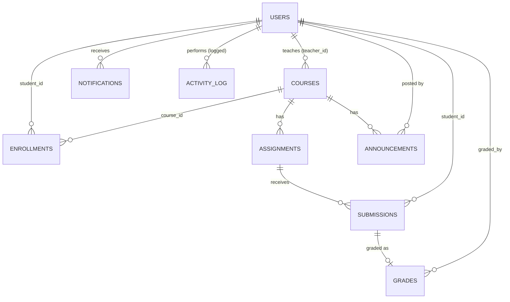

# Student Assignment System

Common project for **CSE3132 Software Engineering Lab**. Teachers create assignments, students submit work (with real file upload), teachers grade with written feedback, students see marks. An admin manages users and courses.

**Extra features:** student self-registration, announcements, in-app notifications with unread counter, activity (audit) log, grade statistics, CSV export of marks, profile with password change. **9 database tables.**

**Stack:** Node.js + Express (API) · SQLite via Node's built-in `node:sqlite` (database file, nothing to compile) · plain HTML/CSS/JavaScript frontend served by Express.

> **Stack note.** You preferred React + Vite. I used plain JavaScript instead so there is **no build step** and one command starts everything. That is the most reliable choice for a beginner on a deadline. Everything else (Express, SQLite, real file upload, server-side role checks) is as requested.

---

## 1. Run it on Windows

1. Install **Node.js 22 LTS** (22.13 or newer; **not** 23/24/25, and do NOT tick the "tools for native modules" box) from https://nodejs.org (accept the defaults). Close and reopen your terminal.
2. Unzip the project, open a terminal in the folder (in File Explorer: click the address bar, type `cmd`, press Enter).
3. Run:
   ```
   npm install
   npm start
   ```
4. Open **http://localhost:3000**. Demo data is created automatically the first time.

To stop: press `Ctrl + C`. To reset all data: stop the server and delete the `data` folder (and files in `uploads`), then start again.

When the server starts you will see an `ExperimentalWarning: SQLite is an experimental feature` message. That is normal and harmless. If `npm start` says `node:sqlite` is not found, your Node is older than 22.13: install Node 22 LTS.

## 2. Demo logins

| Role | Email | Password |
|---|---|---|
| Admin | admin@college.edu | admin123 |
| Teacher (CSE3132) | teacher@college.edu | teacher123 |
| Teacher (CSE3101) | teacher2@college.edu | teacher123 |
| Student | student@college.edu | student123 |
| Student | priya@college.edu | student123 |
| Student | aman@college.edu | student123 |

The login page has Student / Teacher / Admin buttons that fill the form for you. Passwords are stored as bcrypt hashes. These are demo credentials; do not reuse them anywhere real.

## 3. Demo script (the required workflow)

1. Sign in as **Teacher** → *New assignment*.
2. Title `Software Engineering Assignment 1`, subject CSE3132, a description, a future deadline, max marks 50 → *Create assignment*.
3. *Sign out*, sign in as **Student** (Rahul) → *Assignments* → search the title → *Open* → *Submit work* → attach any `.txt`/`.pdf` file and write a note → *Submit work*.
4. Sign in as **Teacher** → *Assignments* → *Submissions* for that assignment → Rahul's card shows the file and answer. Download the file, enter marks and feedback → *Save grade*.
5. Sign in as **Student** → *My grades*: marks and feedback appear. Press **F5**: data is still there (it is in SQLite).
6. Permission check: as Student open `http://localhost:3000/#/admin` → "Access denied". The API also refuses (403), see test T-13.

## 4. Project structure

```
server/
  index.js    starts the server
  app.js      all API routes + role checks (authorisation happens HERE)
  logic.js    business rules: validation, status calculation (pure functions, easy to unit-test)
  db.js       SQLite schema + demo data
public/
  index.html, style.css
  app.js      the whole frontend: helpers -> api -> views -> router
tests/
  logic.test.js, api.test.js      automated tests (node:test)
  selenium/test_workflow.py       Selenium browser test (see section 9)
data/         SQLite file (created on first run, git-ignored)
uploads/      submitted files (git-ignored)
```

## 5. Architecture (for your SRS / viva)

Three layers:

- **Presentation** – `public/`. A single-page app: the URL hash (`#/assignments/5`) selects a view function. It calls the API with `fetch` and a JWT token kept in `localStorage`. Hiding buttons is only for convenience.
- **Application / business logic** – `server/app.js` (routes, `auth` and `requireRole` middleware) and `server/logic.js` (rules). Every route re-checks the user's role and ownership.
- **Data** – SQLite database with foreign keys enabled.

Request flow: browser → `Authorization: Bearer <token>` → `auth` (who are you?) → `requireRole` (are you allowed?) → validation in `logic.js` → SQL → JSON response.

## 6. Data model (ER)



| Table | Key columns |
|---|---|
| users | id PK, name, email UNIQUE, password_hash, role (student/teacher/admin) |
| courses | id PK, code UNIQUE, name, teacher_id FK→users |
| enrollments | (student_id FK, course_id FK) composite PK — many-to-many |
| assignments | id PK, course_id FK, title, description, deadline, max_marks |
| submissions | id PK, assignment_id FK, student_id FK, file_name, file_path, answer_text, is_late, submitted_at; UNIQUE(assignment_id, student_id) |
| announcements | id PK, course_id FK→courses, title, body, created_by FK→users, created_at |
| notifications | id PK, user_id FK→users, message, link, is_read, created_at |
| activity_log | id PK, user_id (no FK on purpose, so history survives deleted users), user_name, action, details, created_at |
| grades | id PK, submission_id FK UNIQUE, marks, feedback, graded_by FK→users, graded_at |

Deleting a course removes its assignments → submissions → grades (`ON DELETE CASCADE`). The full `CREATE TABLE` statements are in `server/db.js`.

## 7. Roles and permissions

| Action | Student | Teacher | Admin |
|---|:-:|:-:|:-:|
| View own/relevant assignments | ✔ (enrolled courses) | ✔ (own subjects) | ✔ (all, read-only) |
| Create / edit / delete assignment | ✘ | ✔ (own subjects only) | ✘ |
| Submit work | ✔ (until graded) | ✘ | ✘ |
| View submissions, download files | own only | own subjects only | ✘ |
| Grade + feedback | ✘ | ✔ (own subjects only) | ✘ |
| Users, courses, enrolment, stats | ✘ | ✘ | ✔ |

Business rules: deadline must be in the future when creating; marks 1–1000; grade must be between 0 and max marks; feedback required; one submission per student per assignment (re-submitting replaces it until graded); submissions after the deadline are accepted and flagged **Submitted late**; uploads limited to 5 MB and a list of safe file extensions.

## 8. Manual test cases

Start with fresh demo data. "Expected" is what you should see.

| ID | Steps | Expected |
|---|---|---|
| T-01 | Login with wrong password | "Invalid email or password." |
| T-02 | Login as each demo role | Lands on role dashboard; sidebar differs per role |
| T-03 | Teacher: New assignment, click *Create* with empty form | Red messages under Title, Subject, Description |
| T-04 | Same form, deadline in the past | "Deadline must be in the future." |
| T-05 | Max marks `0`, `-5`, `abc`, `1001` | "Maximum marks must be a whole number from 1 to 1000." |
| T-06 | Valid data | Assignment created, detail page shown, green toast |
| T-07 | Edit that assignment and change the title | Detail page shows the new title |
| T-08 | Student: submit with no file and no text | "Attach a file or write an answer." |
| T-09 | Student: upload a `.exe` | "This file type is not allowed." |
| T-10 | Student: submit file + note | Status becomes **Submitted** |
| T-11 | Teacher: open Submissions | Student card shows note, file download works |
| T-12 | Teacher: marks above max, or empty feedback | Field error; nothing saved |
| T-13 | As student, open `#/assignments/new` and `#/admin` | "Access denied" |
| T-14 | As student, console: `fetch('/api/stats',{headers:{Authorization:'Bearer '+localStorage.sas_token}}).then(r=>r.status)` | `403` |
| T-15 | Teacher saves valid grade + feedback | Badge **Graded** |
| T-16 | Student: My grades | Marks and feedback shown; press F5 – still shown |
| T-17 | Student tries to re-submit a graded assignment | Not offered in UI; API returns 409 |
| T-18 | Student: search/filter assignments by title, subject, status | List narrows; "No matches" empty state when nothing fits |
| T-19 | Teacher: Delete assignment | Browser confirm dialog first; removed after OK |
| T-20 | Admin: overview | Counts match the tables below them |
| T-21 | Admin: add user with bad email / short password | Field errors; valid user appears in table |
| T-22 | Admin: Courses → Manage students | Tick/untick students, Save; student counts update |
| T-24 | Login page → *Create an account*; submit empty, then valid details | Field errors, then you are signed in as a student who can see assignments |
| T-25 | Teacher posts announcement (try empty first); student opens Announcements | Validation errors, then student sees it; dashboard shows latest 3 |
| T-26 | Teacher creates an assignment; sign in as student | Menu shows red unread count; Notifications lists it; count clears after opening |
| T-27 | Student submits; teacher signs in | Teacher gets "X submitted ..." notification; student gets one when graded |
| T-28 | Teacher: Submissions page | Statistics (submitted, graded, average, highest, lowest) and *Export marks (CSV)* download that opens in Excel |
| T-29 | Profile: wrong current password, then correct | Error, then success; old password stops working |
| T-30 | Admin: Activity log; student opens `#/activity` | Table of actions; student sees "Access denied" |
| T-23 | Resize window to phone width | Layout stacks, nothing overflows sideways |

## 9. Automated tests

**Unit + API tests (Node built-in test runner, no extra packages):**
```
npm test
```
They start the real server on a temporary database and check validation, create/edit, submission with file upload, grading, persistence (close and reopen the database), and role restrictions (student cannot create/grade, teacher cannot use admin routes or another teacher's subjects, etc.).

**Selenium browser test (`tests/selenium/test_workflow.py`):** follows the demo workflow in a real Chrome browser. Elements have stable ids (`#email`, `#login-btn`, `#title`, `#save-assignment-btn`, `#submit-work-btn`, `.marks-input`, `.save-grade-btn`, `#grades-table`, ...) to make locators simple.

1. Install Python 3 (tick "Add to PATH") and Google Chrome.
2. In a terminal: `pip install -r tests/selenium/requirements.txt`
3. Terminal 1: `npm start` (leave it running)
4. Terminal 2: `python tests/selenium/test_workflow.py`

Run it against fresh demo data (delete `data/` first) because the grading test expects Rahul's submission to be the one it just made.

### What was and was not verified (honest status)

- ✔ `npm test`: 30 tests, all passed when I ran them in my Linux sandbox.
- ✔ I drove the whole demo workflow (login, validation errors, create, submit with file, download, grade, student sees grade, refresh, forbidden pages, admin add user, delete with confirm, mobile layout) through a headless Chromium with a Playwright script: 23 checks passed, plus 15 more for registration-era and new features (announcements, notifications, password change, statistics, CSV export, activity log). That script is not included; it is not Selenium.
- ✘ **Not run by me:** the Selenium script (no Selenium or ChromeDriver in my sandbox), anything on Windows, deployment, code coverage, complexity measurement. If the Selenium script needs a locator tweak on your machine, that is normal; the ids it uses all exist.

## 10. Lab evidence – how to measure (I have not invented any numbers)

- **Test coverage:** `npm run test:coverage` prints per-file line/branch coverage for the server code. Report the numbers you get.
- **Cyclomatic complexity:** `pip install lizard` then `lizard server public`. It lists complexity per function. Good candidates to discuss: `validateAssignment`, `assignmentStatus` in `server/logic.js`.
- **Test suite design / white-box testing:** `validateAssignment` and `validateGrade` have clear branches. Derive basis paths from the code, then compare with `tests/logic.test.js`.
- **UML / DFD / ER / state diagrams:** use sections 5–7 above. A good state diagram: assignment status per student (*Pending → Submitted → Graded*, or *Pending → Overdue → Submitted late → Graded*).
- **Git:** `git init`, then `git add .` and commit. `.gitignore` already excludes `node_modules`, the database, and uploads.
- **DevOps / deployment:** any Node host works (start command `npm start`, set `PORT` and a long random `JWT_SECRET`). Note that free hosts often have disk that is wiped on restart, which would lose the SQLite file and uploads. I have not deployed this.

## 11. Explaining the code to a beginner

- `server/logic.js` – small functions like `validateAssignment(data)` that return `{field: message}`. Empty result means valid. Because they do not touch the database, they are easy to test.
- `server/app.js` – each `app.get/post/put/delete(...)` is one URL. `auth` reads the token, `requireRole('teacher')` blocks other roles with 403. SQL uses `?` placeholders so user input can never change the query (prevents SQL injection).
- `public/app.js` – each `xxxView` function fetches data, builds HTML, and attaches button handlers. `esc()` escapes user text so it cannot inject HTML.

## 12. Limitations

- Demo-grade authentication: a fixed fallback `JWT_SECRET` (set the `JWT_SECRET` environment variable for anything real), no password reset, no rate limiting, no HTTPS (needs a host or reverse proxy).
- Self-registration creates **students only** (they are auto-enrolled in all courses). Teacher and admin accounts are created by the admin.
- Deadlines are entered and compared in the server's local time zone (fine for one laptop demo).
- Teachers can only be created and assigned to courses by the admin; there is no course edit form (delete and re-add).
- No pagination (fine for demo data volumes), no email notifications, no multiple files per submission.
- Deleting an assignment, course, or user permanently deletes the related submissions, grades, and uploaded files.
